# CURRENT_ARCHITECTURE.md — ZLMod (`Zalo-Customization`)

> **Trạng thái tài liệu:** Reverse-engineered trực tiếp từ source code thực tế tại commit `e0abf95` (`D:\Documents\GitHub\Zalo-Customization`). Không giả định; mọi điểm không thể xác minh tĩnh từ source code đều được gắn nhãn **`UNKNOWN — NEEDS VERIFICATION`**.

---

## 1. Bản chất thật sự của Application

Dự án này **KHÔNG** phải là một ứng dụng web (React/Next.js/Node.js) và cũng không phải là một ứng dụng iOS độc lập.

Dựa trên toàn bộ mã nguồn (`Sources/`, `Makefile`, `Packaging/`, `Scripts/`, `Resources/`, `Tests/`, `.github/workflows/`), **ZLMod (`Zalo-Customization`)** là:

1. **Một thư viện động iOS Objective-C nguyên bản (`libZLMod.dylib`, kiến trúc `arm64`, minimum iOS `15.1`)**, biên dịch thuần bằng Apple `clang` (`Makefile:1-46`), **không dùng Theos, Cydia Substrate, hay ElleKit**, chỉ liên kết 4 Apple system frameworks: `UIKit`, `Foundation`, `QuartzCore`, `Security`.
2. **Được tiêm (inject) trực tiếp vào tiến trình của ứng dụng Zalo iOS chính chủ đã giải mã** (`vn.com.vng.zingalo` hoặc bản nhân bản sideload `vn.com.vng.zingalo2`) bằng cách thêm `LC_RPATH` (`@executable_path/Frameworks`) và `LC_LOAD_DYLIB` (`@rpath/libZLMod.dylib`) vào Mach-O header của binary `Payload/Zalo.app/Zalo` (`Packaging/macho_injector.py`, `Packaging/package_ipa.py`).
3. **Một pipeline đóng gói & kiểm định IPA bằng Python 3 (`Packaging/`, `Scripts/`, `Tests/`)** kèm GitHub Actions CI/CD trên runner `macos-26` (`.github/workflows/build.yml`, `.github/workflows/release.yml`) để biên dịch `libZLMod.dylib`, chạy contract tests, tiêm vào IPA đã decrypt (`Decrypted/*.ipa`) và xuất 2 biến thể IPA chưa ký (`full-unsigned.ipa` và `noappex-unsigned.ipa`).
4. **Một C-Bridge WebSocket/HTTP client tích hợp (`Sources/ZLModBridge.m`)** kết nối tới một Local Server bên ngoài (được tài liệu hóa trong `.github/workflows/release.yml:22` là `zalo-meet-bot` — **server code KHÔNG tồn tại trong repository này**).

> **Lưu ý về nhận diện phiên bản đang bị lệch (Version Drift):**
> - `Sources/ZLMod.h:12-13`: `ZLMOD_VERSION = @"4.0"`, `ZLMOD_BUILD = @"Build 5"`
> - `Scripts/report.sh:7`: fallback `ZLMOD_VERSION="${ZLMOD_VERSION:-build-5}"`
> - `README.md`, `docs/ARCHITECTURE.md`, `docs/FEATURES.md`, `docs/CHANGELOG.md`: ghi `Build 9`
> - `.github/workflows/release.yml:9,13`: mặc định `ZLMod Build 10 — C-Bridge Edition` / tag `build-10`
> - File IPA đang commit trong `Decrypted/vn.com.vng.zingalo_260401_decrypted_by_TTJB.ipa`: là **Zalo `260401` (build `708`)**, KHÔNG khớp `Resources/compatibility.json` (`261002/261002802` và `261101/261101802`).

---

## 2. Application Entry Points

Hệ thống có **4 nhóm entry point thực tế**:

| Layer | Entry Point | Cơ chế kích hoạt | File:Line |
|---|---|---|---|
| **iOS Runtime Dylib** | `__attribute__((constructor)) static void ZLModEntry(void)` | `dyld` tự chạy khi load `@rpath/libZLMod.dylib` vào tiến trình `Zalo` | `Sources/ZLModCore.m:407-412` |
| **iOS Bootstrap** | `ZLModScheduleBootAfterLaunch()` → `ZLModBootAsync()` → `ZLModBoot()` | 3 trigger chạy đua có khóa `dispatch_once`: (1) `UIApplicationDidFinishLaunchingNotification`, (2) fallback timer `5.0s`, (3) late-injection timer `1.0s` nếu `ZLModActiveKeyWindow() != nil` | `Sources/ZLModCore.m:317-405` |
| **iOS UI Entry Points** | (a) Dòng **ZLMod Customize** trong `SettingUI40TableViewController` (và 4 fallback class)<br>(b) Lắc máy (**Shake Gesture**) trên mọi `UIWindow`<br>(c) Menu nhấn giữ hội thoại (`InboxContextMenuManager`)<br>(d) Menu nhấn giữ bong bóng tin nhắn thu hồi (`MenuButton`) | Runtime method swizzling (`ZLModReplaceMethod`) | `Sources/ZLModSettings.m:641-789`, `Sources/ZLModConversationMenu.m:525-636`, `Sources/ZLModAntiRecall.m:1218-1365` |
| **Build / Packaging CLI** | `Makefile` (`all`, `gates`, `clean`), `Packaging/package_ipa.py`, `Packaging/ipa_preflight.py`, `Packaging/macho_injector.py`, `Scripts/generate_compatibility.py`, `Scripts/project_gate.py`, `Scripts/gates.sh`, `Scripts/anchors-verify.sh`, `Scripts/report.sh` | Chạy từ CLI local hoặc GitHub Actions (`build.yml`, `release.yml`) | `Makefile:1-46`, `Packaging/*.py`, `Scripts/*` |

### Trình tự khởi động (Boot Sequence) thực tế tại `Sources/ZLModCore.m:317-357`

```text
dyld loads @rpath/libZLMod.dylib
  └─► ZLModEntry() [constructor, trên thread khởi tạo của dyld]
        └─► ZLModScheduleBootAfterLaunch()
              ├─ Observe UIApplicationDidFinishLaunchingNotification ──┐
              ├─ dispatch_after(5.0s, main_queue) ─────────────────────┼─► ZLModBootAsync()
              └─ dispatch_after(1.0s, main_queue) if keyWindow != nil ─┘
                                                                          │
                    [Chạy trên DISPATCH_QUEUE_PRIORITY_DEFAULT (background!)]
                                                                          ▼
                                                                     ZLModBoot() (dispatch_once)
                                                                          │
                    1. Log version/build/hostVersion/supportReason
                    2. Check [ZLModCompatibility hostSupported] ──(NO)──► Dừng idle, không install module
                    3. ZLModInstallSessionLifecycleObservers()
                         ├─ Hook AppDelegate -didLogout & -didLogin
                         └─ Observe NSNotification @"kNotifyDidLogoutAnimation"
                    4. Chạy tuần tự 11 module installer (mỗi installer bọc trong @try/@catch):
                         [1]  URIFilter        → ZLModURIFilterInstall()
                         [2]  Privacy          → ZLModPrivacyInstall()
                         [3]  Ads              → ZLModAdsInstall()
                         [4]  Features         → ZLModFeaturesInstall()
                         [5]  Settings         → ZLModSettingsInstall()
                         [6]  Glass            → ZLModGlassInstall()
                         [7]  ConversationMenu → ZLModConversationMenuInstall()
                         [8]  AntiRecall       → ZLModAntiRecallInstall()
                         [9]  Utilities        → ZLModUtilitiesInstall()
                         [10] Theme            → ZLModThemeInstall()
                         [11] Bridge           → ZLModBridgeInstall()
                    5. dispatch_async(main_queue):
                         ZLModShowToast(@"✨ ZLMod Customize đã kích hoạt! Lắc máy hoặc vào Cài đặt để mở menu.")
```

> **Cảnh báo kiến trúc:** `ZLModBoot()` thực thi toàn bộ 11 installer trên **global background queue** (`ZLModCore.m:355`), trong khi nhiều installer tương tác với UIKit classes (`UIWindow`, `UITabBar`, `UINavigationBar`), khởi tạo singleton, hoặc đọc `NSBundle`/`NSUserDefaults`. Một số hàm tự `dispatch_async(main_queue)`, nhưng không nhất quán.

---

## 3. Phân tầng Kiến trúc (In-Process Client & External Pipeline)

Vì đây là một iOS dynamic library tiêm vào ứng dụng host, khái niệm "Frontend / Backend" ánh xạ vào kiến trúc thực tế như sau:

### 3.1. UI / Presentation Layer ("Frontend" trong tiến trình Zalo)
- **Settings Entry Injector (`Sources/ZLModSettings.m`, 789 dòng):**
  - Hook toàn cục `[UIWindow motionEnded:withEvent:]` để mở menu bằng cử chỉ lắc máy.
  - Hook `SettingUI40TableViewController` (fallback: `SettingUITableViewController`, `BasicSettingTableViewController`, `ZaloSettingViewController`, `SettingTableViewController`) ở 7 selectors (`viewDidLoad`, `viewWillAppear:`, `viewDidAppear:`, `updateTitleObjects`, `tableView:didSelectRowAtIndexPath:`, `tableView:numberOfRowsInSection:`, `tableView:cellForRowAtIndexPath:`).
  - Tìm model hàng "Tài khoản và bảo mật" (`_accountAndSecurityObject` / key `00Zh8W`) bằng thuật toán BFS trên đồ thị ivar (tối đa độ sâu 7, 4.000 node), nhân bản thô (`memcpy` + `CFRetain`) và chèn row "ZLMod Customize" vào mảng section của Zalo; nếu không tìm thấy sẽ bật `gFallbackActive` chèn hàng thủ công ở `(section 0, row 0)`.
- **Dashboard & 7 Child View Controllers (`Sources/ZLModUI.m`, 1.247 dòng):**
  - `ZLModSettingsViewController` (`UITableViewController`, `InsetGrouped`, 10 sections).
  - 7 màn hình con:
    1. `ZLModBridgeViewController` (C-Bridge: CPairing, Local Server URL/Token, Discord Webhook, CDeploy, CSaving)
    2. `ZLModConversationPoliciesViewController` (xem & reset per-conversation policies)
    3. `ZLModAntiRecallHistoryViewController` (xem, giải mã & xóa lịch sử Ghost Preview)
    4. `ZLModQuickRepliesViewController` (CRUD, sắp xếp lại, chèn mẫu vào khung chat)
    5. `ZLModPrivateNotesViewController` (xem, sửa & xóa ghi chú mã hóa theo hội thoại)
    6. `ZLModModuleStatusViewController` (xem trạng thái `HOOK_INSTALLED` / `NOT_INSTALLED` của các module)
    7. `ZLModLogViewerController` (xem, sao chép, xóa 200 dòng log đã redact)
- **In-Place Host UI Injections:**
  - `ZLModConversationMenu.m`: chèn 4 action vào menu nhấn giữ hội thoại (`InboxContextMenuManager` — hỗ trợ mảng lồng section `NSArray<NSArray *>`), vẽ chấm xanh `#0068FF` (`tag=0x5A1D`) lên `UXInboxMessageCell` & `ChatListItemCell`, hiển thị toast (`ZLModShowToast`).
  - `ZLModAntiRecall.m`: chèn nút **Hiện** (`99001`) / **Ẩn** (`99002`) vào menu bong bóng tin nhắn (`MenuButton`), sửa trực tiếp `UILabel.text` trong cell, trình chiếu ảnh thu hồi (`ZLModPhotoPreviewController` fullscreen pinch-zoom + save/copy).
  - `ZLModUtilities.m`: thanh **Undo Banner** nổi (`tag=0x5A1E`) đếm ngược hoãn gửi tin nhắn + `UIAlertController` sửa Private Note.
  - `ZLModGlass.m`: áp dụng `UIBlurEffectStyleSystemUltraThinMaterial` vào `UITabBarAppearance` của `ZaloTabBarViewController` (đã loại bỏ `UIGlassEffect` do freeze trên compatibility mode).
  - `ZLModTheme.m`: áp dụng 4 theme presets + custom hex tint lên `UIWindow.overrideUserInterfaceStyle`, `tintColor`, `UINavigationBarAppearance`, `UITabBarAppearance` với lưu/khôi phục baseline qua associated objects.
  - `ZLModAds.m`: ép `hidden = YES`, `alpha = 0.0`, `userInteractionEnabled = NO` trên `ZInstantFeedAdsView` và `LocationOAAdsCell`.

### 3.2. Domain / Runtime Hook & Service Layer ("In-Process Core")
- **Hook Engine (`Sources/ZLModHookEngine.m`, 243 dòng):**
  - Quét `objc_getClassList` 1 lần và cache vĩnh viễn danh sách class thuộc ảnh binary Zalo (`class_getImageName` chứa `.app/` hoặc `/Zalo`, loại trừ `/libZLMod.dylib`).
  - `ZLModReplaceMethod` / `ZLModReplaceClassMethod`: xác thực arity (`declaredArgs + 2`), return encoding head (`allowedReturns`), chống hook trùng qua `NSMutableSet` khóa `@synchronized`.
  - Safe Property Readers: `ZLModSafeObjectProperty`, `ZLModSafeStringProperty`, `ZLModSafeBoolProperty`, `ZLModSafeInt64Property`, `ZLModSafeDoubleProperty` (kiểm tra `respondsToSelector:` + `numberOfArguments == 2` + type encoding trước khi `objc_msgSend`).
- **Compatibility Guard (`Sources/ZLModCompatibility.m`, 71 dòng + `Sources/ZLModCompatibilityData.h` sinh từ `Resources/compatibility.json`):**
  - Kiểm tra khớp chính xác `(version, build, bundleId)` với `261002/261002802` và `261101/261101802`, **TUY NHIÊN** có fallback động ở dòng 22-30 cho phép chạy trên MỌI bản Zalo chứa các class `ZaloTabBarViewController`/`SettingUI40TableViewController`/`ChatDataManager`/`ChatMessage` hoặc `bundleId` chứa `zalo`/`zing`.
- **Crypto & Multi-Account Scope (`Sources/ZLModCryptoStore.m`, 414 dòng):**
  - `ZLModCurrentAccountScope()`: đọc `userId` từ 4 singleton Zalo (`ZAApplicationContext`, `ChatDataManager`, `ChatSendSeenDataManager`, `FTSDatabaseManager`), băm SHA-256 thành `acc_<16hex>`, fail-closed (`nil`) nếu chưa xác định.
  - `ZLModCryptoBox`: lưu 256-bit master key trong iOS Keychain (`kSecAttrAccessibleAfterFirstUnlockThisDeviceOnly`), dẫn xuất khóa con `ENC` và `MAC` bằng SHA-256, mã hóa `AES-256-CBC` + `HMAC-SHA256` (v2, Encrypt-then-MAC, so sánh MAC hằng thời gian).
- **Privacy & Policy (`Sources/ZLModPolicyStore.m`, `Sources/ZLModPrivacy.m`, `Sources/ZLModURIFilter.m`):**
  - `ZLModPrivacyContext`: theo dõi hội thoại đang mở qua `BaseChatTVC -zaloViewDidAppear:` / `-zaloViewWillDisappear:`.
  - `ZLModConversationPolicyStore`: lưu chính sách Seen/Typing/LocalUnread theo `(accountScope, convType, threadId)`.
  - `ZLModPrivacy`: hook 15 phương thức instance/class của Zalo để chặn typing, seen, read receipts, friend-request seen, và tắt Firebase SDK (`FIRAnalytics`, `FIRPerformance`, `FIRCrashlytics`).
  - `ZLModURIFilter`: đăng ký `ZLModBlockURLProtocol` qua `[NSURLProtocol registerClass:]` trả về HTTP `204` rỗng cho URL tracking/ads.
- **Messaging Features (`Sources/ZLModAntiRecall.m`, `Sources/ZLModUtilities.m`, `Sources/ZLModFeatures.m`):**
  - `ZLModAntiRecallStore`: cache live snapshot trong RAM (tối đa 500) + lưu bản ghi tin nhắn thu hồi mã hóa xuống `ZLModAntiRecall.plist` (TTL 14 ngày, tối đa 400 bản ghi/account).
  - `ZLModDelaySendManager`: FSM 5 trạng thái (`Pending` → `Cancelled` / `Dispatching` → `Dispatched` / `Failed`) trên `ZAChatSendingManager -sendChat:checkUpload:`.
  - `ZLModQuickReplyStore` + `ZLModPrivateNotesStore`.
  - `ZLModFeatures`: ghi đè getters Profile Music, bridge Google Drive backup section, mirror external keys (`enable_tabmore`, `restore_gdrive_photo_csc`, `kProfileMusicSetting`, ...).

### 3.3. Backend / External Server Architecture
- **Không có backend server code trong repo này.**
- `Sources/ZLModBridge.m` đóng vai trò **client** giao tiếp với:
  1. **Local Server (C-Bridge Server — `zalo-meet-bot` theo `.github/workflows/release.yml:22`):**
     - WebSocket: `ws(s)://<host>[:port]/cbridge/ws?token=...&account=...&userId=...`
     - HTTP Healthcheck: `GET <serverUrl>/api/cbridge/health` *(lưu ý: đang bị bug `stringByAppendingPathComponent:` làm hỏng `http://` → `http:/`!)*
     - **Server implementation:** `UNKNOWN — NEEDS VERIFICATION` (nằm ngoài repo này).
  2. **Discord Webhook API:**
     - `POST <user_configured_webhook_url>` (chỉ dùng trong nút Test Webhook; chưa có luồng relay sự kiện thực tế).
  3. **Zalo Native Runtime / Backend (Host App):**
     - ZLMod không gọi trực tiếp Zalo REST/WebSocket API; toàn bộ tương tác với Zalo đều qua **Objective-C runtime method swizzling** trên các class nội bộ của tiến trình `Zalo.app`.

### 3.4. Build, Packaging & Verification Pipeline (Offline Toolchain)
- `Scripts/generate_compatibility.py`: biên dịch `Resources/compatibility.json` → `Sources/ZLModCompatibilityData.h`.
- `Makefile`: gọi `xcrun --sdk iphoneos clang -dynamiclib` biên dịch 18 file `.m` → `build/libZLMod.dylib` + `codesign --force --sign -`.
- `Scripts/gates.sh`: 7 cổng kiểm định tĩnh trên binary `libZLMod.dylib` (`file`, `otool -L`, `otool -D`, `otool -l`, `nm -m`, `codesign -dv`, kích thước > 20 KB).
- `Packaging/macho_injector.py` + `Packaging/package_ipa.py`: giải nén IPA decrypted → cập nhật `Info.plist` & `PlugIns/*.appex/Info.plist` (hoặc xóa `PlugIns/` khi `--no-appex`, tự xóa appex còn `cryptid != 0`) → chép `libZLMod.dylib` vào `Frameworks/` → tiêm `LC_RPATH` & `LC_LOAD_DYLIB` → ad-hoc codesign nếu có `codesign` → nén lại thành IPA unsigned → chạy forensic check nội bộ.
- `Packaging/ipa_preflight.py`: kiểm định read-only file IPA (SHA-256, `cryptid`, Mach-O inventory, code signature superblob `0xFADE0CC0`, installability gate).
- `Tests/test_*.py` (9 file, 47 unit/contract tests — chủ yếu là source-code string contract tests + synthetic Mach-O tests bằng Python, **không chạy Objective-C runtime test thật trên iOS**).

---

## 4. Data Flow tổng quan

```mermaid
flowchart TD
    subgraph ZaloHost["Tiến trình Zalo iOS (vn.com.vng.zingalo / zingalo2)"]
        ZNet["Zalo Networking (NSURLSession / Socket)"]
        ZDB["Zalo ConversationModel / ChatDataManager / ChatEntity"]
        ZSend["ZAChatSendingManager"]
        ZUI["Zalo UI (SettingUI40, TabBar, InboxCell, BaseChatTVC, MenuButton)"]
        ZAuth["AppDelegate / ZAApplicationContext / FTSDatabaseManager"]
    end

    subgraph ZLModCore["ZLMod Dylib (libZLMod.dylib)"]
        Core["ZLModCore + HookEngine + Compatibility"]
        Prefs["ZLModPreferences (NSUserDefaults + App Group)"]
        Crypto["ZLModCryptoStore (Keychain AES-256-CBC + HMAC-SHA256 + accountScope)"]
        Policy["ZLModPolicyStore + PrivacyContext"]
        Privacy["ZLModPrivacy + URIFilter + Ads + Features"]
        Recall["ZLModAntiRecall (Live Cache + Encrypted Store + In-Place UI)"]
        Utils["ZLModUtilities (DelaySend FSM + QuickReply + PrivateNotes)"]
        Menu["ZLModConversationMenu (ContextMenu + Blue Dot)"]
        Look["ZLModTheme + ZLModGlass + ZLModSettings + ZLModUI"]
        Bridge["ZLModBridgeManager (WebSocket + HTTP)"]
    end

    subgraph Storage["Lưu trữ cục bộ trên iPhone"]
        KC["iOS Keychain (master_key_v2)"]
        UD["NSUserDefaults (vn.com.vng.zingalo.zlmod + group.zsettings...)"]
        Plists["Documents/ZLMod*.plist (Policies, AntiRecall, Notes, QuickReplies)"]
        Logs["Documents/ZLMod.log (+ AppGroup/ZLMod.log)"]
    end

    subgraph External["Dịch vụ bên ngoài"]
        LocalSrv["Local C-Bridge Server (ws/http)"]
        Discord["Discord Webhook (Test only)"]
    end

    Core --> Prefs & Crypto & Policy & Privacy & Recall & Utils & Menu & Look & Bridge
    ZAuth -->|userId / didLogin / didLogout| Crypto & Core
    ZNet <-->|NSURLProtocol / Socket Hooks| Privacy
    ZDB -->|didLoadChats / addChat / recall| Recall
    Recall -.->|"NSNotification (ONLY when AntiRecall=ON!)"| Bridge
    ZSend <-->|sendChat:checkUpload: 5-state FSM| Utils
    ZUI <-->|Swizzled UIKit & Zalo VC hooks| Menu & Look & Recall & Policy
    Crypto <--> KC
    Prefs <--> UD
    Policy & Recall & Utils <--> Plists
    Core --> Logs
    Bridge <-->|WS /cbridge/ws & GET /api/cbridge/health| LocalSrv
    Bridge -->|POST test only| Discord
```



---

## 5. Tổng quan State Management, API, Realtime, Persistence, Auth & Integrations

| Khía cạnh | Thực trạng hiện tại | Tài liệu chi tiết |
|---|---|---|
| **State Management** | Phân tán qua 10+ Objective-C singletons (`+shared`), biến `static` file-scope (`gOurRow`, `gFallbackActive`, `gUnhiddenMessageKeys`, `gHookedMethods`, `gAppClasses`, `gGlassApplied`, ...), associated objects trên UIKit views, và `NSNotificationCenter` (6 notification tự định nghĩa + 4 UIKit/Zalo notifications). Không có unidirectional store. | [DATA_MODEL.md](./DATA_MODEL.md) |
| **API Architecture** | (1) 2 endpoint HTTP/WS tới Local Server (`ws /cbridge/ws`, `GET /api/cbridge/health` bị bug URL); (2) 1 endpoint `POST` Discord Webhook (chỉ test); (3) 47+ Objective-C method hooks trên binary Zalo; (4) 10 URL filter rules (`NSURLProtocol`); (5) 4 Python CLI tools. | [API_SPEC.md](./API_SPEC.md) |
| **Realtime Architecture** | (1) Native WebSocket (`NSURLSessionWebSocketTask`) trong `ZLModBridgeManager` với heartbeat 20s, reconnect 5s cố định (có race condition stale-task và 3x duplicate reconnect); (2) In-process reactive bus qua `NSNotificationCenter`; (3) Real-time hook intercept trên Zalo message arrival, recall, typing, seen, send. | [REALTIME_SPEC.md](./REALTIME_SPEC.md) |
| **Persistence** | 1 Keychain item (`vn.com.vng.zingalo.zlmod.keystore / master_key_v2`), 3 `NSUserDefaults` domains (`vn.com.vng.zingalo.zlmod`, `group.zsettings.vn.com.vng.zingalo`, `standardUserDefaults`), 4 binary `.plist` trong `Documents/` (`ZLModPolicies.plist`, `ZLModAntiRecall.plist`, `ZLModNotes.plist`, `ZLModQuickReplies.plist`), và file log xoay vòng `ZLMod.log` (max 512 KB). | [DATA_MODEL.md](./DATA_MODEL.md) |
| **Authentication / Identity** | Không tự login Zalo. Đọc `userId` hiện tại từ runtime Zalo để tạo `accountScope = acc_<sha256_16hex>` (fail-closed khi chưa xác định). C-Bridge dùng shared secret token lưu plaintext trong `NSUserDefaults` và gửi qua query string WebSocket (`?token=...`) hoặc header `Authorization: Bearer`. | [FEATURE_SPEC.md](./FEATURE_SPEC.md), [TECHNICAL_DEBT.md](./TECHNICAL_DEBT.md) |
| **External Integrations** | (1) Zalo iOS Host App (`26.10.02`, `26.11.01`, và fallback động cho `26.04.01` với 6/86 anchor bị thiếu); (2) Local C-Bridge Server (`zalo-meet-bot` — bên ngoài repo); (3) Discord Webhook; (4) Apple Keychain / Security / CommonCrypto; (5) Firebase SDK (trong Zalo, để vô hiệu hóa); (6) GitHub Actions (`macos-26`, Xcode, `softprops/action-gh-release@v2`). | [CURRENT_ARCHITECTURE.md](./CURRENT_ARCHITECTURE.md), [TECHNICAL_DEBT.md](./TECHNICAL_DEBT.md) |

---

## 6. High-Level Dependency Graph (Các module trong `Sources/`)

```text
                        ┌──────────────────────┐
                        │   ZLMod.h (Umbrella) │
                        └──────────┬───────────┘
                                   │
         ┌─────────────────────────┼─────────────────────────┐
         ▼                         ▼                         ▼
┌─────────────────┐      ┌──────────────────┐      ┌────────────────────┐
│ ZLModCore       │      │ ZLModHookEngine  │      │ ZLModPreferences   │
│ (Boot, Logging, │      │ (Class scan, ABI │      │ (UserDefaults +    │
│  ModuleStatus,  │      │  ReplaceMethod,  │      │  AppGroup mirror)  │
│  Session hooks) │      │  SafeProperties) │      └─────────┬──────────┘
└────────┬────────┘      └────────┬─────────┘                │
         │                        │                          │
         ├────────────────────────┤                          │
         ▼                        ▼                          │
┌────────────────────┐  ┌─────────────────────┐              │
│ ZLModCompatibility │  │ ZLModCryptoStore    │              │
│ (compatibility.json│  │ (Keychain AES/HMAC, │              │
│  + runtime check)  │  │  accountScope)      │              │
└────────────────────┘  └──────────┬──────────┘              │
                                   │                         │
                 ┌─────────────────┼─────────────────┐       │
                 ▼                 ▼                 ▼       ▼
        ┌────────────────┐ ┌───────────────┐ ┌────────────────────┐
        │ ZLModPolicy    │ │ ZLModAnti     │ │ ZLModUtilities     │
        │ Store          │ │ Recall        │ │ (Notes, QuickReply,│
        │ (Context+Store)│ │ (Cache+InPlace│ │  DelaySend FSM)    │
        └───────┬────────┘ │  +PhotoModal) │ └─────────┬──────────┘
                │          └───────┬───────┘           │
        ┌───────┴───────┐          │ (HIDDEN COUPLING!)│
        ▼               ▼          ▼                   │
┌──────────────┐ ┌──────────────┐ ┌───────────────┐    │
│ ZLModPrivacy │ │ ZLModConv    │ │ ZLModBridge   │    │
│ (Seen/Typing/│ │ Menu (Menu + │ │ (WS CPairing, │    │
│  Firebase)   │ │  Blue Dot +  │ │  CSaving,     │    │
└──────────────┘ │  Toast!)     │ │  CDeploy,     │    │
                 └──────┬───────┘ │  Webhook)     │    │
                        │         └───────┬───────┘    │
   ┌────────────────────┼─────────────────┼────────────┘
   │                    │ (Exports ZLModShowToast!)
   ▼                    ▼
┌───────────────────────────────────────────────────────────┐
│ Leaf Feature Modules (chỉ phụ thuộc Core/Hook/Prefs):     │
│  - ZLModURIFilter  - ZLModAds  - ZLModFeatures            │
│  - ZLModGlass      - ZLModTheme                           │
└─────────────────────────────┬─────────────────────────────┘
                              ▼
                    ┌──────────────────┐
                    │ ZLModSettings    │◄────┐ (Circular: Settings
                    │ (Row clone+Shake)│     │  pushes SettingsVC;
                    └────────┬─────────┘     │  UI imports all
                             ▼               │  managers & stores)
                    ┌──────────────────┐     │
                    │ ZLModUI          │─────┘
                    │ (Dashboard + 7VC)│
                    └──────────────────┘
```

> **Phát hiện vòng phụ thuộc / ghép nối bất thường (Coupling Anomalies):**
> 1. **`ZLModShowToast()` được định nghĩa trong `ZLModConversationMenu.m:14-64`** nhưng được gọi bởi `ZLModCore.m`, `ZLModBridge.m`, `ZLModUtilities.m`, `ZLModUI.m`, `ZLModAntiRecall.m`! Nếu tách/gỡ `ZLModConversationMenu.m`, toàn bộ project không thể link.
> 2. **`ZLModBridge` phụ thuộc ngầm vào `ZLModAntiRecall`:** `ZLModBridge.m:73` lắng nghe `@"ZLModChatEntityArrivedNotification"`, notification này CHỈ được post tại `ZLModAntiRecall.m:624`, và CHỈ chạy khi `kZLModAntiRecall == YES` (`ZLModAntiRecall.m:1068, 1136, 1151`). Do đó **CSaving chết hoàn toàn nếu tắt Anti-Recall!**
> 3. **`ZLModSettings` ↔ `ZLModUI`:** `ZLModSettings.m` gọi `[ZLModSettingsViewController pushFrom:]` (`ZLModUI.m`), còn `ZLModUI.m` hiển thị trạng thái `SettingUI40TableViewController` và `extern ZLModGlassMaterialDescription()` (liên kết ngầm trực tiếp không khai báo trong `ZLMod.h`).
> 4. **`ZLModTheme` ↔ `ZLModGlass`:** Cả hai cùng sửa `UITabBar.standardAppearance` & `scrollEdgeAppearance` và cùng tự lưu baseline riêng biệt (`gSavedStandard` vs associated object `kZLModBaselineStdAppAssocKey`), gây ghi đè chéo khi bật/tắt xen kẽ.
