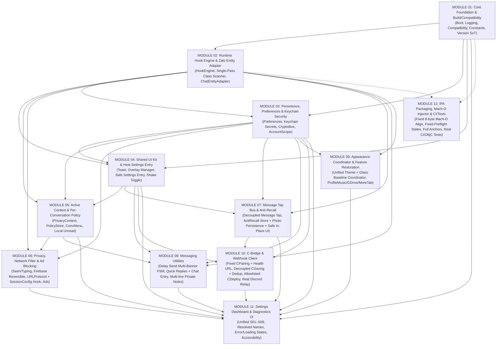

# REBUILD_PLAN.md — Feature Dependency Graph (Phase 17) & Modular Rebuild Strategy (Phase 18)

> **CHƯA THỰC HIỆN REBUILD.** Tài liệu này là bản thiết kế lộ trình để bạn có thể ra lệnh từng phần (VD: `"Rebuild MODULE 01"`, `"Rebuild MODULE 08"`) với đầy đủ hợp đồng giao tiếp, phụ thuộc và kiểm thử cần thiết.

---

## PHẦN A — PHASE 17: FEATURE DEPENDENCY GRAPH (DỰA TRÊN APPLICATION THỰC TẾ)

### Phân lớp phụ thuộc (Foundational → Feature → Presentation → Toolchain)
- **Tầng 0 — Offline Toolchain (có thể sửa độc lập song song sớm nhất để mọi build sau đó sạch):** `MODULE 12`
- **Tầng 1 — Foundational (Bắt buộc đi trước mọi feature):** `MODULE 01` → `MODULE 02` → `MODULE 03` → `MODULE 04`
- **Tầng 2 — Domain Core (Có thể rebuild song song sau Tầng 1):** `MODULE 05`, `MODULE 06`, `MODULE 07`, `MODULE 08`, `MODULE 09`
- **Tầng 3 — External Integration:** `MODULE 10` (phụ thuộc `Message Tap` ở `MODULE 07`, KHÔNG phụ thuộc toggle Anti-Recall!)
- **Tầng 4 — Dashboard UI Integration:** `MODULE 11`

---

## PHẦN B — PHASE 18: MODULAR REBUILD STRATEGY

---

### MODULE 01 — Core Foundation, Boot Lifecycle & Compatibility Policy
- **Current implementation:** `Sources/ZLMod.h`, `Sources/ZLModCore.m`, `Sources/ZLModCompatibility.m`, `Sources/ZLModCompatibilityData.h`, `Resources/compatibility.json`, `Scripts/generate_compatibility.py`.
- **Problems:**
  1. Version drift (`ZLMod.h` ghi `Build 5`, `report.sh` ghi `build-5`, `README/docs` ghi `Build 9`, `release.yml` ghi `Build 10`).
  2. `ZLModBoot()` chạy tất cả 11 installer trên background queue gây rủi ro UIKit main-thread violation.
  3. `ZLModCompatibility.hostSupported` có fallback chứa `"zalo"`/`"zing"` quá rộng và mâu thuẫn với `supportReason` & `ipa_preflight.py`.
  4. `ZLModCore.m` gọi trực tiếp `ZLModShowToast()` định nghĩa ở `ZLModConversationMenu.m` (phụ thuộc ngược).
  5. Log redactor chưa che pattern Discord Webhook URL.
- **Dependencies:** Apple `Foundation`, `UIKit` (chỉ main queue khi hiển thị), `Resources/compatibility.json`.
- **Target architecture:**
  - Single Source of Truth cho `ZLMOD_VERSION` / `ZLMOD_BUILD` (từ `Resources/version.json` hoặc Makefile define) dùng chung cho `ZLMod.h`, `report.sh`, CI.
  - Boot phân pha rõ ràng: **Phase A (Background-safe):** Compatibility + Core/Crypto/Prefs; **Phase B (Main Queue):** UIKit/Settings/Glass/Theme installers.
  - Chính sách Compatibility tường minh 2 chế độ: `ExactAllowlist` vs `VerifiedRuntimeAnchors` (bỏ hoàn toàn khớp substring `"zalo"`/`"zing"`, đồng nhất `hostSupported` với `supportReason` và `ipa_preflight.py`).
  - Gom toàn bộ magic constants (`0x5A1D`, `0x5A1E`, `9101–9104`, `99001–99002`, TTL, caps) vào `ZLModConstants.h`.
- **Target behavior:** Boot an toàn thread 100%, fail-closed nhất quán, báo cáo chính xác lý do tương thích, log redact cả webhook URL & secrets.
- **Required API:** `ZLModBoot`, `ZLModRegisterModuleInstaller`, `ZLModSetModuleStatus`, `ZLModAllModuleStatuses`, `ZLModLog`, `ZLModRedactText`, `ZLModCompatibility`.
- **Required state:** `gModuleStatuses`, `gRingBuffer` (200 lines), `ZLMod.log` (512 KB rotating), `ZLModAccountDidChangeNotification`.
- **Required UI:** Chỉ thông qua callback/delegate tới Toast (MODULE 04), không phụ thuộc ngược vào `ConversationMenu`.
- **Required tests:** Contract & unit test cho Compatibility (exact vs runtime verified vs non-Zalo app containing `"zing"`), redaction regex (token, Bearer, phone/UID, Discord webhook), version consistency gate.
- **Migration strategy:** Tách `ZLModConstants.h`, chuẩn hóa `ZLModCompatibility.m` và boot phase trước khi rebuild các module tầng trên; giữ nguyên public header `ZLMod.h` trong giai đoạn chuyển tiếp.

---

### MODULE 02 — Runtime Hook Engine & Zalo Entity Adapter
- **Current implementation:** `Sources/ZLModHookEngine.m` + code trích xuất `ChatEntity` lặp lại trong `ZLModAntiRecall.m:530-595`, `ZLModBridge.m:370-395`, `ZLModPrivacy.m:40-95`.
- **Problems:**
  1. Quét ~19.645 app classes **10+ lần** khi boot (`Privacy` 3 lần, `Features` 6 lần).
  2. 3 module tự đọc property của `ChatEntity` bằng 3 bộ selector khác nhau (gây bug thiếu field ở CSaving).
  3. `ZLModActiveKeyWindow()` & `ZLModTopPresenterViewController()` có thể bị gọi từ background thread.
  4. `Scripts/anchors.txt` thiếu các symbol đang dùng trong `AntiRecall` và `ConversationMenu`.
- **Dependencies:** `MODULE 01`, `objc/runtime`.
- **Target architecture:**
  - **Single-pass class index / batch registration** trong `ZLModHookEngine`: gom các predicate quét class của mọi module, duyệt `objc_getClassList` đúng 1 lần lúc boot.
  - **`ZLModChatEntityAdapter` (mới):** Chuẩn hóa `id chatEntity` → immutable `ZLModMessageModel` (`globalId`, `clientId`, `threadId`, `senderId`, `senderName`, `text`, `timestampMs`, `timestampSec`, `isSelf`, `isGroup`, `isRecalled`, `messageKind`) dùng chung cho Anti-Recall, Privacy, và CSaving.
  - Assert/dispatch-safe cho `ZLModActiveKeyWindow()` & `ZLModTopPresenterViewController()`.
- **Target behavior:** Giảm 90% chi phí quét class lúc khởi động; mọi module đọc cùng một dữ liệu chuẩn hóa từ `ChatEntity`.
- **Required API:** `ZLModReplaceMethod`, `ZLModReplaceClassMethod`, `ZLModRegisterClassScanBatch`, `ZLModSafe*Property`, `ZLModChatEntityAdapter`.
- **Required state:** `gAppClasses`, `gHookedMethods` (thread-safe).
- **Required UI:** Không.
- **Required tests:** Anchor manifest completeness test (tự động quét mọi `NSClassFromString` / `sel_registerName` trong `Sources/` và bắt buộc có trong `Scripts/anchors.txt`); unit test cho `ZLModMessageModel` normalization.
- **Migration strategy:** Thêm `ZLModChatEntityAdapter` và API single-pass trước, sau đó chuyển lần lượt `Privacy`, `AntiRecall`, `Bridge`, `Features` sang dùng adapter mới.

---

### MODULE 03 — Persistence, Preferences & Keychain Security
- **Current implementation:** `Sources/ZLModPreferences.m`, `Sources/ZLModCryptoStore.m`.
- **Problems:**
  1. `kZLModBridgeToken` và `kZLModBridgeWebhook` lưu **plaintext trong `NSUserDefaults` + App Group**!
  2. Gọi deprecated `[NSUserDefaults synchronize]` ở mọi thao tác ghi.
  3. `resetAllPreferences` bắn 21+1 notifications riêng lẻ gây bão observer.
  4. Các store ghi file đồng bộ dưới `os_unfair_lock`; `ZLModPolicies.plist` & `ZLModNotes.plist` lưu `threadId` plaintext.
  5. Không phân biệt được lỗi Keychain (`errSecMissingEntitlement`) với trạng thái rỗng ở tầng UI.
- **Dependencies:** `MODULE 01`, `MODULE 02`, `Security.framework`, `CommonCrypto`.
- **Target architecture:**
  - **Tách rạch ròi Secret Store vs Preferences:** Chuyển `kZLModBridgeToken` và `kZLModBridgeWebhook` sang **iOS Keychain** (`ZLModSecretStore`, cùng accessibility `kSecAttrAccessibleAfterFirstUnlockThisDeviceOnly`, KHÔNG bao giờ mirror ra App Group).
  - Loại bỏ `[synchronize]`, thêm batch transaction cho `resetAllPreferences` & CDeploy (chỉ bắn **1** notification tổng hợp sau khi ghi xong).
  - Bổ sung `ZLModStorageHealth` (báo rõ `Ready` / `AccountUnidentified` / `KeychainUnavailable(OSStatus)`) để UI hiển thị cảnh báo thay vì giả thành Empty State.
  - Tách ghi đĩa plist ra serial background I/O queue (snapshot immutable dưới lock → ghi atomic ngoài lock).
- **Target behavior:** Zero secrets trong `NSUserDefaults`; không block lock khi I/O; giữ tương thích migrate đọc 1 lần secret cũ từ `NSUserDefaults` sang Keychain rồi xóa khỏi `NSUserDefaults`.
- **Required API:** `ZLModPreferences`, `ZLModSecretStore`, `ZLModCryptoBox`, `ZLModAccountScopeProvider`, `ZLModStorageHealth`.
- **Required state:** `NSUserDefaults` (non-secret prefs), Keychain (`master_key_v2` + bridge secrets), cached `accountScope`.
- **Required UI:** Hiển thị trạng thái sức khỏe Keychain/AccountScope trong Diagnostics & các màn store.
- **Required tests:** Contract test khẳng định không có secret key nào được ghi vào `NSUserDefaults`/`AppGroup`; test migration plaintext → Keychain; test Keychain fail-closed reporting.
- **Migration strategy:** Khi boot lần đầu sau upgrade, tự động đọc `kZLModBridgeToken`/`kZLModBridgeWebhook` cũ (nếu có), ghi sang Keychain, rồi `removeObjectForKey:` khỏi `own` và `group` defaults.

---

### MODULE 04 — Shared UI Kit & Host Settings Entry
- **Current implementation:** `ZLModShowToast` (đang nằm nhầm trong `ZLModConversationMenu.m:14-64`) + `Sources/ZLModSettings.m` (789 dòng).
- **Problems:**
  1. `ZLModShowToast` đặt sai chỗ tạo vòng phụ thuộc.
  2. `ZLModCloneObject` dùng `memcpy` + `CFRetain` nguy hiểm với ARC/weak ivars.
  3. Fallback row mode lệch index ở các `UITableViewDelegate` method khác (`heightForRowAtIndexPath:`, `willDisplayCell:`, ...).
  4. BFS 4.000 node chạy lặp lại trên main thread mỗi lần mở Settings.
  5. Shake-to-Open không có công tắc tắt và đụng chuẩn iOS "Shake to Undo Typing".
  6. `gOurRow` / `gFallbackActive` là global static không reset khi Settings VC tái tạo.
- **Dependencies:** `MODULE 01`, `MODULE 02`, `MODULE 03`, `UIKit`.
- **Target architecture:**
  - Tách **`ZLModToastOverlay`** (hỗ trợ hàng đợi toast, Dynamic Type, VoiceOver announcement, tránh bàn phím).
  - **`ZLModSettingsEntryManager`:**
    - Chuyển trạng thái injected row từ static globals sang **associated object gắn theo từng instance `UITableViewController`**.
    - Thay raw `memcpy` cloning bằng cách ưu tiên khởi tạo/copy chính thức (`copyWithZone:` / `init` + KVC an toàn) hoặc header/footer button / navigation bar button (`UIBarButtonItem` hình bánh răng / logo ZLMod ngay trên thanh điều hướng Settings Zalo!) làm fallback sạch 100% không làm lệch `indexPath` của `UITableView`!
    - Thêm preference `kZLModShakeToOpen` (mặc định `YES` để dễ cứu hộ, nhưng cho phép tắt; tự bỏ qua khi có `firstResponder` đang nhập text để tránh đụng Undo Typing).
- **Target behavior:** Lối vào Settings không bao giờ làm hỏng ARC hay lệch row; Shake không phá Undo Typing.
- **Required API:** `ZLModShowToast`, `ZLModSettingsInstall`, `kZLModShakeToOpen`.
- **Required state:** Per-VC associated state (không còn static `gOurRow`/`gFallbackActive`).
- **Required UI:** Toast overlay + Settings Entry (NavBar item / Safe Row) + Shake trigger.
- **Required tests:** Unit/contract test không còn `memcpy` trên ObjC ivar; test `ZLModShowToast` độc lập khỏi `ConversationMenu`.
- **Migration strategy:** Di chuyển `ZLModShowToast` trước (giữ nguyên chữ ký hàm C), rồi nâng cấp `ZLModSettings.m` giữ nguyên lối mở `ZLModSettingsViewController +pushFrom:`.

---

### MODULE 05 — Active Chat Context, Per-Conversation Policy & Inbox Menu
- **Current implementation:** `Sources/ZLModPolicyStore.m`, `Sources/ZLModConversationMenu.m`.
- **Problems:**
  1. Selector `contextMenu:didSelectActionId:forIdentifier:` và class `ChatListItemCell` **không tồn tại** trên IPA `260401/708` (chỉ có trên `261002`/`261101`).
  2. `docs/FEATURES.md` nhắc `InboxContextMenuProvider` nhưng code chưa hook.
  3. `ZLModPolicies.plist` chỉ lưu `threadHash`, không lưu tên hội thoại đã mã hóa → S03 chỉ hiển thị `Cá nhân • h_a1b2c3d4` rất khó dùng.
  4. Chấm xanh chưa đọc không tự tắt khi mở hội thoại (nếu user muốn) và không có accessibility label.
- **Dependencies:** `MODULE 02`, `MODULE 03`, `MODULE 04`.
- **Target architecture:**
  - Mở rộng `ZLModPolicies.plist` (schema v3, tương thích ngược v2): tùy chọn lưu thêm `encryptedDisplayTitle` bằng `ZLModCryptoBox` để S03 hiện tên hội thoại dễ nhận diện.
  - Chuẩn hóa `ZLModPrivacyContext` dùng stack `NSHashTable`/array thay vì 1 pointer đơn lẻ để không bị `willDisappear:` của VC cũ xóa nhầm active thread khi push/pop nhanh.
  - Hỗ trợ đa phiên bản Zalo cho Inbox Context Menu (cả `InboxContextMenuManager` lẫn `InboxContextMenuProvider` khi xác minh trên IPA đích).
- **Target behavior:** Nhấn giữ hội thoại hoạt động ổn định trên cả sectioned & flat menu; quản lý policy hiển thị tên hội thoại rõ ràng.
- **Required API:** `ZLModPrivacyContext`, `ZLModConversationPolicyStore`, `ZLModConversationMenuInstall`.
- **Required state:** `Documents/ZLModPolicies.plist` (v3), active VC stack, weak cell hash table.
- **Required UI:** Inbox long-press section (4 actions) + Blue Dot (`tag=0x5A1D` có accessibility).
- **Required tests:** Schema migration test v2 → v3; context stack push/pop test; sectioned vs flat array menu injection test.
- **Migration strategy:** Tự động đọc schema v2 & nâng cấp sang v3 khi ghi mà không làm mất policy hiện có của user.

---

### MODULE 06 — Privacy (Seen, Typing, Firebase), Network Filter & Ad Blocking
- **Current implementation:** `Sources/ZLModPrivacy.m`, `Sources/ZLModURIFilter.m`, `Sources/ZLModAds.m`.
- **Problems:**
  1. `ZLModBlockURLProtocol` chỉ đăng ký bằng `[NSURLProtocol registerClass:]` → **bị bypass bởi mọi `NSURLSession` dùng custom `NSURLSessionConfiguration` và `WKWebView`**.
  2. `ZLModApplyFirebaseState()` có `if (!blocked) return;` → tắt toggle **không bao giờ bật lại Firebase**.
  3. `ChatSocketCmdHelper +sendStatusTyping:...` kiểm tra `activeThreadId` thay vì đích thực sự của lệnh socket.
  4. `ZLModAds.m` khi tắt `kZLModHideAds` không khôi phục `alpha`/`userInteractionEnabled` của view đã ẩn, và không thu gọn chiều cao cell.
- **Dependencies:** `MODULE 02`, `MODULE 03`, `MODULE 05`.
- **Target architecture:**
  - `ZLModURIFilter`: hook thêm `[NSURLSessionConfiguration protocolClasses]` (hoặc `defaultSessionConfiguration`/`ephemeralSessionConfiguration`) để chèn `ZLModBlockURLProtocol` vào đầu danh sách protocol classes của mọi `NSURLSession` mới tạo trong Zalo (bảo vệ vòng lặp chống đệ quy + bỏ qua C-Bridge & Discord hosts!).
  - `ZLModPrivacy`: sửa `ZLModApplyFirebaseState()` gọi `set...CollectionEnabled:!blocked` (hoặc lưu trạng thái ban đầu trước khi tắt để khôi phục đúng); tách rõ trạng thái cài đặt của từng nhóm hook.
  - `ZLModAds`: khôi phục thuộc tính view khi tắt toggle; tách bạch rõ view disarm vs network block.
- **Target behavior:** Chặn tracking/ads hiệu quả trên cả `NSURLSession` hiện đại của Zalo; mọi toggle đều **reversible 100%** khi tắt.
- **Required API:** `ZLModURIFilterInstall`, `ZLModPrivacyInstall`, `ZLModAdsInstall`.
- **Required state:** `ZLModPreferences` toggles + `ZLModConversationPolicyStore`.
- **Required UI:** 7 toggles trong S01 (Privacy + Ad Blocking).
- **Required tests:** Contract test xác nhận Firebase toggle gọi cả `YES` và `NO`; test `NSURLSessionConfiguration` protocol injection không ảnh hưởng tới `ZLModBridgeManager`.
- **Migration strategy:** Thay thế nội bộ 3 module, giữ nguyên toàn bộ 7 preference keys.

---

### MODULE 07 — Decoupled Message Tap Bus & Anti-Recall Engine
- **Current implementation:** `Sources/ZLModAntiRecall.m` (1.372 dòng — đang kiêm luôn nguồn sự kiện cho CSaving!).
- **Problems:**
  1. **Coupling nghiêm trọng:** `ZLModChatEntityArrivedNotification` bị khóa trong `if (kZLModAntiRecall)` → làm chết CSaving khi tắt Anti-Recall!
  2. **Rò bộ nhớ `liveByKey`:** `altKey` (`c_<cid>`) không bao giờ bị xóa khi `liveOrder` evict.
  3. **False-positive text filter:** Mọi tin nhắn thật chứa chữ `"thu hồi"`/`"recalled"` bị bỏ lọt không snapshot và không hiện khi giải mã!
  4. **Ảnh thu hồi không bền vững:** Không lưu ảnh đã mã hóa xuống disk → mất ảnh khi Zalo xóa cache hoặc restart app.
  5. **Cell reuse bug:** `kZLModOrigRecallTextKey` trên `UILabel` không được dọn khi cell reuse; gọi `set_originTextRecallMsg:` trái nguyên tắc non-mutating.
  6. **Dead code:** `ZLModPresentRecalledMessageContent` (`__attribute__((unused))`).
- **Dependencies:** `MODULE 02`, `MODULE 03`, `MODULE 04`.
- **Target architecture:**
  - Tách làm 3 file rõ trách nhiệm:
    1. **`ZLModMessageTap.m` (mới):** Hook `didLoadChats:config:`, `addChats:...`, `addChat:...`, `updateDBWhenRecalledChats:completion:` **chỉ khi `kZLModAntiRecall || kZLModBridgeSaving` đang bật**, chuyển qua `ZLModChatEntityAdapter` (MODULE 02), phát sự kiện `ZLModMessageObservedEvent` & `ZLModMessageRecalledEvent` độc lập cho cả Anti-Recall và C-Bridge CSaving!
    2. **`ZLModAntiRecallStore.m`:** Sửa cấu trúc eviction xóa đồng bộ cả `primaryKey` và `altKey` (lưu cặp keys trong `liveOrder` hoặc `ZLModLiveSnapshot`), thay heuristic lọc chuỗi `"thu hồi"` bằng kiểm tra flag thực `isRecalled` (fallback khớp chính xác chuỗi placeholder toàn câu thay vì `containsString:`), tùy chọn lưu thumbnail/ảnh mã hóa có giới hạn dung lượng (VD max 20 MB LRU), xóa dead code.
    3. **`ZLModAntiRecallUI.m`:** In-place Unhide/Hide + `ZLModPhotoPreviewController`, dọn dẹp sạch associated objects khi reuse cell, bỏ mutation `set_originTextRecallMsg:` nếu không cần thiết (chỉ dựa vào dynamic hook + reloadCell).
- **Target behavior:** Zero memory leak; tin chứa chữ "thu hồi" vẫn được lưu bình thường; CSaving chạy hoàn toàn độc lập với Anti-Recall; ảnh thu hồi xem được sau restart (trong giới hạn quota).
- **Required API:** `ZLModMessageTap`, `ZLModAntiRecallStore`, `ZLModAntiRecallInstall`.
- **Required state:** `liveByKey` (leak-free LRU 500), `Documents/ZLModAntiRecall.plist` (v2/v3, TTL 14d), `gUnhiddenMessageKeys`.
- **Required UI:** Nút `Hiện`/`Ẩn` trên `MenuButton`, `ZLModPhotoPreviewController`, S04 History.
- **Required tests:** Unit test kiểm chứng eviction xóa cả `primaryKey` & `altKey`; test tin nhắn thật `"đừng thu hồi nhé"` KHÔNG bị lọc bỏ; test `MessageTap` phát sự kiện cho CSaving ngay cả khi `kZLModAntiRecall == NO`.
- **Migration strategy:** Đọc tương thích ngược `Documents/ZLModAntiRecall.plist` schema v2 hiện có.

---

### MODULE 08 — Messaging Utilities (Delay Send, Quick Replies, Private Notes)
- **Current implementation:** `Sources/ZLModUtilities.m` (848 dòng).
- **Problems:**
  1. **Delay Send:** Gửi 2 tin liên tiếp trong cửa sổ delay xóa mất banner hủy của tin 1; text không đếm ngược live theo giây; vị trí banner cố định dễ bị bàn phím che; không có toast báo khi `origIMP` thất bại hoặc khi auto-cancel do background.
  2. **Quick Replies:** Không có đường tắt mở từ màn chat; không báo lỗi khi đạt trần 50 mẫu; nút Reset Defaults không hỏi xác nhận.
  3. **Private Notes:** Editor `UIAlertController` 1 dòng `UITextField` không gõ được nhiều dòng; không báo lỗi khi fail-closed/Keychain lỗi; danh sách S06 chỉ hiện `threadHash` không hiện tên hội thoại.
- **Dependencies:** `MODULE 02`, `MODULE 03`, `MODULE 04`, `MODULE 05`.
- **Target architecture:**
  - Tách 3 file: `ZLModDelaySend.m`, `ZLModQuickReply.m`, `ZLModPrivateNotes.m`.
  - **Delay Send:** Banner hỗ trợ **đếm ngược 1s tick** + hiển thị số lượng tin đang chờ (`"Đang chờ gửi (2 tin — 3s)... [Hủy tất cả] / [Hủy gần nhất]"`), tự nâng vị trí theo `UIKeyboardWillChangeFrameNotification`, báo toast nếu `Failed`.
  - **Quick Replies:** Giữ nguyên cơ chế safe composer insert (không bao giờ tự gửi), thêm cảnh báo khi đạt giới hạn 50 mẫu, xác nhận trước khi Reset Defaults, và tùy chọn lối mở nhanh (VD: nút phụ trên input bar hoặc Action trong Shake Quick Menu — cần xác nhận với user).
  - **Private Notes:** Thay `UIAlertController` 1 dòng bằng modal `UIViewController` có `UITextView` nhiều dòng, lưu thêm `encryptedDisplayTitle`, và hiện lỗi rõ nếu `ZLModStorageHealth != Ready`.
- **Target behavior:** Giữ nguyên 5-state atomic FSM an toàn của Delay Send; nâng cấp UX & reliability cho cả 3 tiện ích.
- **Required API:** `ZLModDelaySendManager`, `ZLModQuickReplyStore`, `ZLModPrivateNotesStore`, `ZLModPresentPrivateNoteEditor`.
- **Required state:** `Documents/ZLModNotes.plist`, `Documents/ZLModQuickReplies.plist`, in-memory `ZLModPendingSendItem` queue.
- **Required UI:** Multi-item keyboard-aware Undo Banner, Multi-line Note Modal, S05, S06.
- **Required tests:** FSM concurrency tests; quick reply cap/error handling; notes encryption & fail-closed UI error reporting.
- **Migration strategy:** Tương thích ngược hoàn toàn `ZLModNotes.plist` v2 và `ZLModQuickReplies.plist`.

---

### MODULE 09 — Appearance Coordinator (Theme + Glass) & Feature Restoration
- **Current implementation:** `Sources/ZLModTheme.m`, `Sources/ZLModGlass.m`, `Sources/ZLModFeatures.m`.
- **Problems:**
  1. `ZLModTheme` và `ZLModGlass` tranh chấp quyền sở hữu và lưu 2 baseline độc lập cho `UITabBarAppearance`.
  2. `ZLModGlass` vẫn mang tên/tài liệu "Liquid Glass (UIGlassEffect iOS 26)" dù đã bỏ hẳn `UIGlassEffect`.
  3. `ZLModTheme` im lặng xóa hex sai mà không báo lỗi.
  4. `ZLModFeatures` còn sót tên `ZyForceBoolGetter` và quét class 6 lần lúc boot; 2 GDrive selectors thiếu trên bản `260401`.
- **Dependencies:** `MODULE 02`, `MODULE 03`.
- **Target architecture:**
  - **`ZLModAppearanceCoordinator`:** Giữ **1 baseline duy nhất** của Zalo gốc cho `UIWindow` / `UINavigationBar` / `UITabBar`; mọi cập nhật dựng lại appearance theo pipeline thuần túy: `OriginalBaseline → ApplyTheme(preset, tint) → ApplyTabBarMaterial(glassBlur)`. Khi tắt cả hai → trả nguyên 100% `OriginalBaseline`.
  - Cập nhật nhãn UI trung thực (`"Translucent Blur Tab Bar"` hoặc ghi rõ material blur).
  - Refactor `ZLModFeatures.m` dùng single-pass class scanner (MODULE 02), đổi `ZyForceBoolGetter` → `ZLModForceBoolGetter`.
- **Target behavior:** Bật/tắt Theme và Glass theo bất kỳ thứ tự nào đều khôi phục chính xác 100% giao diện gốc của Zalo.
- **Required API:** `ZLModThemeManager`, `ZLModGlassCoordinator`, `ZLModFeaturesInstall`.
- **Required state:** `kZLModGlassTabBar`, `kZLModThemePreset`, `kZLModThemeTintHex`, 3 feature toggles + 6 external keys backup.
- **Required UI:** Appearance & Feature Restoration sections trong S01 (báo lỗi rõ khi nhập hex sai).
- **Required tests:** Test trình tự `Theme ON → Glass ON → Theme OFF → Glass OFF` và ngược lại đều trả về baseline gốc; test `project_gate` cấm luôn `ZyForce`.
- **Migration strategy:** Giữ nguyên các preference keys hiện có.

---

### MODULE 10 — C-Bridge & Discord Webhook Client
- **Current implementation:** `Sources/ZLModBridge.h`, `Sources/ZLModBridge.m`.
- **Problems (NẶNG NHẤT TOÀN DỰ ÁN):**
  1. **BROKEN Healthcheck URL (`ZLModBridge.m:472`):** `stringByAppendingPathComponent:` biến `http://` → `http:/`.
  2. **BROKEN CSaving:** Chết hoàn toàn khi tắt Anti-Recall; thiếu local dedup; re-enqueue lỗi làm đảo thứ tự & phá trần 50; thiếu fallback selectors & loại `Undo`.
  3. **CRITICAL Security (`applyRemoteSettings:`):** Ghi đè mọi key bất kỳ không allowlist!
  4. **Secrets Plaintext & URL Query Auth:** Token trong `NSUserDefaults` & `?token=...` encode sai ký tự `&`/`=`/`+`.
  5. **Race Conditions & Reconnect Storm:** 3x reconnect từ S02; stale cancelled WS task ghi đè trạng thái socket mới; không có backoff & pong timeout; `handleAppDidEnterBackground` rỗng; `status`/`savedMessagesCount` truy cập không có lock.
  6. **Unimplemented Promised Features:** Không có LAN auto-discovery (CPairing) và không có Discord Webhook event relay thực tế (chỉ có nút test).
  7. **Upload CDeploy** không cập nhật `kZLModBridgeLastSync` và không chờ ACK.
- **Dependencies:** `MODULE 02` (`ZLModChatEntityAdapter`), `MODULE 03` (`ZLModSecretStore`), `MODULE 04` (`ZLModShowToast`), `MODULE 07` (`ZLModMessageTap`).
- **Target architecture:**
  - **URL Builder an toàn:** Dùng `NSURLComponents` xây dựng cả HTTP `/api/cbridge/health` lẫn WS `/cbridge/ws` (giữ base path nếu có), truyền token qua HTTP header `Authorization: Bearer <token>` ngay trong `NSMutableURLRequest` của `webSocketTaskWithRequest:` (thay vì query string!) và percent-encode chuẩn RFC 3986.
  - **Connection State Machine an toàn:** Gắn `connectionEpoch` (hoặc kiểm tra `webSocketTask == self.webSocketTask`) trong mọi delegate/completion; dùng **exponential backoff** (`2s → 4s → 8s → 16s → max 30s`, reset khi `Connected`), có **pong timeout (10s)**, dừng sạch ở `handleAppDidEnterBackground`, khóa trạng thái bằng `os_unfair_lock` hoặc serial dispatch queue riêng.
  - **CSaving độc lập & bền vững:** Subscribe `ZLModMessageTap` (chạy kể cả khi Anti-Recall OFF), dùng `ZLModChatEntityAdapter` hỗ trợ cả sự kiện `chat.undo`, thêm **local LRU dedup set** (VD 500 `identityKey`), re-enqueue vào **đầu** hàng đợi và giữ nghiêm trần `kZLModMaxPendingMessages`.
  - **CDeploy an toàn:** Enforce **explicit allowlist 17 non-secret keys** (tuyệt đối từ chối `serverUrl`, `token`, `webhook`, `zlmod.internal.*`); gửi `cdeploy_ack` có xử lý hàng đợi nếu presenter đang bận; chờ server `cdeploy_upload_ack` rồi mới cập nhật `kZLModBridgeLastSync`.
  - **Discord Webhook & CPairing Discovery (Cần xác nhận phạm vi với user!):**
    - Validate host `https://discord.com/api/webhooks/...` hoặc `discordapp.com`, lưu URL trong Keychain (`MODULE 03`), và nếu user cần: nối luồng relay thực tế (VD: tin thu hồi, cảnh báo kết nối) có rate-limit & toggle riêng.
    - Nếu user cần CPairing LAN discovery thật: triển khai `NWBrowser` / `NSNetServiceBrowser` (`_zlmod-cbridge._tcp`) hoặc gỡ bỏ câu quảng cáo tự phát hiện trong UI!
- **Target behavior:** CPairing, CSaving, CDeploy và Webhook hoạt động tin cậy, bảo mật và tách biệt hoàn toàn khỏi Anti-Recall.
- **Required API:** WS `/cbridge/ws` (header auth), HTTP `GET /api/cbridge/health`, Discord Webhook `POST`, protocol schema v1 đồng bộ với `zalo-meet-bot`.
- **Required state:** Serial queue protected Bridge state, bounded FIFO queue + LRU dedup set, Keychain secrets.
- **Required UI:** S02 (không gọi duplicate notif/reconnect, có spinner loading & cập nhật latency live).
- **Required tests:** Test URL builder (`http://192.168.1.15:3000` → `http://192.168.1.15:3000/api/cbridge/health`), test CDeploy allowlist chặn ghi đè `serverUrl`/`token`/`webhook`, test CSaving hoạt động khi `AntiRecall=OFF`, test re-enqueue giữ thứ tự & cap 50, test stale WS task bị bỏ qua.
- **Migration strategy:** Di dời secret sang Keychain (MODULE 03), đồng bộ nhẹ phía server `zalo-meet-bot` nếu đổi WS auth từ query sang header (có thể hỗ trợ tạm thời cả header + query opt-in trong giai đoạn chuyển tiếp).

---

### MODULE 11 — Settings Dashboard & Child Management UI
- **Current implementation:** `Sources/ZLModUI.m` (1.247 dòng chứa cả 8 `UITableViewController`).
- **Problems:**
  1. Một file khổng lồ 1.247 dòng chứa 8 controllers.
  2. S02 bắn duplicate notification + 3x reconnect, không reuse cell, không có spinner loading.
  3. S01 giải mã toàn bộ Private Notes ở mỗi `viewWillAppear:`, không lắng nghe `ZLModBridgeStatusDidChangeNotification`.
  4. S03/S04/S06 trộn lẫn fail-closed error với empty state, chỉ hiện `threadHash`, S04 cấp phát `NSDateFormatter` trong `cellForRowAtIndexPath:`, S05 reset defaults không xác nhận.
  5. Ngôn ngữ Anh–Việt lộn xộn, thiếu Dynamic Type & VoiceOver labels.
- **Dependencies:** `MODULE 01` → `MODULE 10`.
- **Target architecture:**
  - Tách mỗi màn hình hoặc nhóm logic thành file nhỏ: `ZLModDashboardVC.m`, `ZLModBridgeVC.m`, `ZLModPrivacyManagementVC.m` (Policies + AntiRecall), `ZLModUtilitiesVC.m` (QuickReplies + Notes), `ZLModDiagnosticsVC.m` (ModuleStatus + LogViewer).
  - Bỏ nút CSaving trùng lặp hoặc đồng bộ 2 chiều sạch sẽ qua 1 nguồn notification duy nhất.
  - Dùng `countForCurrentAccount` (đếm metadata không cần giải mã AES) trên S01; dùng static/cached `NSDateFormatter`; dùng cell reuse cho S02; thêm `UIRefreshControl` cho S07/S08; hiển thị banner cảnh báo rõ khi `ZLModStorageHealth != Ready`.
  - Thống nhất ngôn ngữ hiển thị (100% tiếng Việt nhất quán hoặc i18n bundle) và chuẩn hóa Accessibility / Dynamic Type.
- **Target behavior:** Mượt mà, nhất quán, có loading/empty/error state thật sự cho mọi thao tác.
- **Required API:** Chỉ đọc/gọi public interfaces từ MODULE 01–10.
- **Required state:** View-local state + observe các notification chuẩn hóa.
- **Required UI:** S01–S08.
- **Required tests:** Contract tests kiểm tra không có duplicate notification posts từ UI layer, có confirmation cho destructive actions, và reuse identifiers đầy đủ.
- **Migration strategy:** Giữ nguyên entry point `[ZLModSettingsViewController pushFrom:]` nên không ảnh hưởng `ZLModSettings`.

---

### MODULE 12 — Offline Packaging, Mach-O Injector, Preflight & CI Verification
- **Current implementation:** `Packaging/macho_injector.py`, `Packaging/package_ipa.py`, `Packaging/ipa_preflight.py`, `Scripts/*`, `Tests/*`, `.github/workflows/build.yml`, `.github/workflows/release.yml`, `Decrypted/*.ipa`.
- **Problems:**
  1. **BUG Mach-O Alignment (`macho_injector.py:158-159`):** `LC_RPATH` `cmdsize = 12 + align8(len)` không chia hết cho 8 (`4 mod 8`), phá vỡ căn lề 64-bit ARM64!
  2. **BUG Preflight State (`ipa_preflight.py:281-297`):** Báo sai `PROVISIONED_AND_SIGNED` khi `CodeResources=True` & `MobileProvision=False`.
  3. **CI `build.yml:133-138`:** Không đính kèm `build/*.ipa` lên pre-release dù đã build xong.
  4. **CI `release.yml:109-116`:** Tải `decrypted_ipa_url` không kiểm tra SHA-256.
  5. **Bundled IPA mismatch:** `Decrypted/vn.com.vng.zingalo_260401_decrypted_by_TTJB.ipa` (`260401/708`) không khớp `compatibility.json` (`261002`/`261101`) và thiếu 6/86 anchors.
  6. **Tests chưa đủ chiều sâu:** Thiếu test kiểm tra alignment `% 8 == 0`, thiếu test partial-signature preflight, thiếu ObjC compile/unit test thật.
- **Dependencies:** Python 3 stdlib, macOS Xcode CI.
- **Target architecture:**
  - Sửa `inject_rpath_slice`: `cmdsize = align8(12 + len(rpath_bytes))`, kiểm tra `cmdsize % 8 == 0` và `new_sizeofcmds % 8 == 0` cho mọi load command tiêm vào.
  - Sửa `evaluate_installability`: tách rõ 4 trạng thái (`UNSIGNED_ARCHIVE`, `PARTIAL_SIGNATURE_MISSING_PROVISION`, `STALE_SIGNATURE_MISMATCH`, `PROVISIONED_AND_SIGNED`).
  - Đồng bộ `build.yml` và `release.yml` (đính kèm IPA + optional `decrypted_ipa_sha256` input + xác minh preflight compatibility).
  - Mở rộng `Scripts/anchors.txt` đủ 100% symbols thực dùng và thêm test tự động đối chiếu với `Sources/*.m`.
  - Xử lý quyết định về file IPA `260401/708` trong `Decrypted/` (cần xác nhận với user).
- **Target behavior:** Mọi IPA đóng gói ra có header Mach-O 64-bit chuẩn căn lề Apple 100%, báo cáo preflight trung thực, CI phát hành nhất quán.
- **Required API:** Giữ nguyên CLI interface hiện tại của `package_ipa.py`, `ipa_preflight.py`, `macho_injector.py`.
- **Required tests:** Bổ sung regression tests cho 8-byte Mach-O alignment, partial-signing preflight state, và anchor coverage.
- **Migration strategy:** **Khuyến nghị làm MODULE 12 ĐẦU TIÊN (hoặc song song MODULE 01)** để bảo đảm mọi bản dựng dylib & IPA của các module sau đều được kiểm định trên pipeline chính xác.

---

## Thứ tự thực thi Rebuild khuyến nghị

1. **`MODULE 12`** — Sửa Mach-O alignment, Preflight bug, Anchor manifest & CI (nền tảng build/test đáng tin cậy)
2. **`MODULE 01`** — Core Foundation, Boot threading, Compatibility policy & Version Single Source of Truth
3. **`MODULE 02`** — Hook Engine (Single-pass scanner) & `ZLModChatEntityAdapter`
4. **`MODULE 03`** — Keychain Secret Store, Preferences batching, Non-blocking Persistence & StorageHealth
5. **`MODULE 04`** — Shared UI Kit (`ZLModShowToast`) & Safe Host Settings Entry + Shake Toggle
6. **`MODULE 05`** — PrivacyContext stack, PolicyStore v3 & Multi-version Inbox Context Menu
7. **`MODULE 06`** — Privacy (Reversible Firebase, Seen/Typing), `NSURLSessionConfiguration` URL Filter & Ads
8. **`MODULE 07`** — Decoupled `ZLModMessageTap` + Leak-free Anti-Recall (Fix `"thu hồi"` filter & photo persistence)
9. **`MODULE 10`** — C-Bridge Rebuild (Fix CPairing health URL, decouple CSaving, allowlist CDeploy, WS epoch/backoff, Webhook)
10. **`MODULE 08`** — Utilities Rebuild (Multi-banner keyboard-aware DelaySend, QuickReply UX, Multi-line Notes)
11. **`MODULE 09`** — Unified Appearance Coordinator (Theme + Glass baseline) & Feature Restoration
12. **`MODULE 11`** — Modular Dashboard & Diagnostics UI Rebuild (S01–S08)

---

## Execution Status (ZLMod 4.0 / Build 11 — 2026-11-26)

| Module | Status | Notes |
|---|---|---|
| MODULE 01 — Core Foundation, Boot, Compatibility, Version SoT | ✅ Implemented & Statically Verified | `Resources/version.json`, `Scripts/generate_version.py`, `Sources/ZLModVersionData.h`, `Sources/ZLModConstants.h`, `Sources/ZLMod.h`, `Sources/ZLModCompatibility.m`, `Sources/ZLModCore.m` |
| MODULE 02 — Hook Engine & `ZLModChatEntityAdapter` | ✅ Implemented & Statically Verified | `Sources/ZLModHookEngine.m`, `Sources/ZLModChatEntityAdapter.m` |
| MODULE 03 — Persistence, Preferences, Keychain Secret Store & Health | ✅ Implemented & Statically Verified | `Sources/ZLModCryptoStore.m`, `Sources/ZLModPreferences.m` |
| MODULE 04 — Shared UI Kit & Safe Settings Entry | ✅ Implemented & Statically Verified | `Sources/ZLModOverlayUI.m`, `Sources/ZLModSettings.m` |
| MODULE 05 — Active Chat Context, Policy Store & Conversation Menu | ✅ Implemented & Statically Verified | `Sources/ZLModPolicyStore.m`, `Sources/ZLModConversationMenu.m` |
| MODULE 06 — Privacy, Network Filter & Reversible Ads | ✅ Implemented & Statically Verified | `Sources/ZLModPrivacy.m`, `Sources/ZLModURIFilter.m`, `Sources/ZLModAds.m` |
| MODULE 07 — Decoupled Message Tap Bus & Anti-Recall | ✅ Implemented & Statically Verified | `Sources/ZLModMessageTap.m`, `Sources/ZLModAntiRecall.m` |
| MODULE 08 — Messaging Utilities | ✅ Implemented & Statically Verified | `Sources/ZLModUtilities.m` |
| MODULE 09 — Unified Appearance Coordinator & Feature Restoration | ✅ Implemented & Statically Verified | `Sources/ZLModTheme.m`, `Sources/ZLModGlass.m`, `Sources/ZLModFeatures.m` |
| MODULE 10 — C-Bridge FSM, CSaving, CDeploy & Discord Relay | ✅ Implemented & Statically Verified | `Sources/ZLModBridge.h`, `Sources/ZLModBridge.m` |
| MODULE 11 — Settings Dashboard & Diagnostics UI (S01–S08) | ✅ Implemented & Statically Verified | `Sources/ZLModUI.m` |
| MODULE 12 — Packaging, Alignment, Preflight, Anchors, CI & Tests | ✅ Implemented & Verified on Windows (Python) | `Packaging/*`, `Makefile`, `Scripts/*`, `.github/workflows/*`, `Tests/*` (72 tests: 71 passed, 1 skipped) |

Full verification evidence and environment blockers (macOS `clang` / physical iPhone runtime tests) are recorded in `FINAL_FIX_REPORT.md`.
